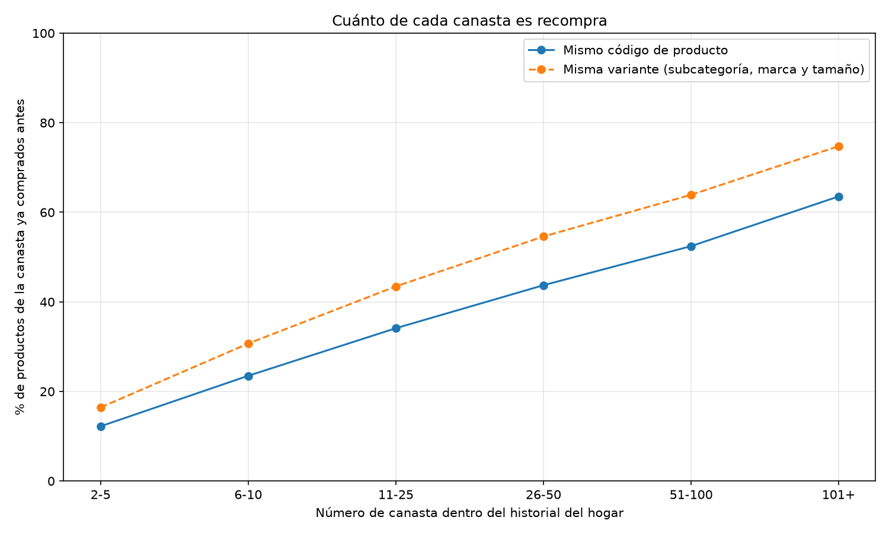

ITRN

Licenciatura en Ingeniería de datos e Inteligencia artificial

**PROYECTO INTEGRADOR — ENTREGABLE 2: INFORME FINAL**

Aplicaciones de Aprendizaje Automático

Alejandra Ramírez - 5019273-4

Katerin Gonzalez - 5580268-9

Luisa Flores - 5534744-3

Alvaro Barreto - 5536617-2

**02/11/2026**

Repositorio: [github.com/alejandra-ramirez-000/AAA_Recomendador_Cupones](https://github.com/alejandra-ramirez-000/AAA_Recomendador_Cupones)

---

# Resumen

Construimos una prueba de concepto que, a partir del historial de compras
anonimizado de cada hogar, propone **10 productos candidatos a cupón**: 7 que el
hogar ya compra (*repeat*) y 3 que todavía no compró (*explore*). Usamos el
dataset dunnhumby — *The Complete Journey* (2,6 millones de líneas de compra de
2.500 hogares durante 711 días).

El sistema final combina un modelo simple de **frecuencia + recencia** para
repeat y **ALS implícito** (filtrado colaborativo) para explore, seguido de
**reglas de negocio** que descartan productos no ofrecibles (combustible, tabaco,
variantes repetidas). Elegimos los modelos y la mezcla usando una canasta de
validación por hogar y los evaluamos **una sola vez** sobre una canasta de
prueba nunca vista.

En prueba, el **50,7 %** de los hogares compró al menos uno de los 10 productos
sugeridos en su siguiente canasta (Hit Rate@10). El componente repeat acierta en
el 64,5 % de los hogares; ALS supera a la popularidad en explore (8,6 % frente a
6,5 %) y recomienda 13 veces más productos distintos. Una app en Streamlit
muestra el recorrido completo con explicaciones por producto, tanto para
cualquier hogar real como para un **cliente simulado** armado en el momento
(sección 9.2), para poder demostrar el sistema en vivo durante la defensa.

Los resultados miden coincidencia con compras posteriores, **no el efecto causal
de un cupón**: demostrar que un cupón aumenta ventas requeriría una prueba A/B.

---

# 1. Problema, usuario y valor esperado

Los supermercados lanzan promociones con frecuencia, pero una promoción general
puede ser relevante para un cliente e irrelevante para otro. Los programas de
fidelización permiten asociar compras a un hogar y reconstruir su historial.

**Pregunta del proyecto:** *¿cómo utilizar el historial de compras de un cliente
para recomendar productos sobre los cuales ofrecer cupones personalizados?*

**Usuario directo:** el área comercial, de marketing o de fidelización. El
sistema no decide si se emite un cupón: entrega **candidatos explicados** que
luego pasan por decisiones comerciales (presupuesto, stock, margen, campañas).

**Beneficiarios:** el cliente recibiría promociones más relacionadas con sus
hábitos; el supermercado aprovecharía mejor los datos de fidelización.

**Dos objetivos distintos:**

- **Repeat:** productos que el hogar ya compró y probablemente vuelva a
  necesitar. Es el objetivo más fácil de predecir.
- **Explore:** productos que el hogar no compró pero podrían interesarle. Es
  mucho más difícil, pero evita que el sistema solo recomiende lo conocido.

Separarlos permite evaluar cada uno con su propia vara: si se mezclaran, el
sistema se optimizaría hacia recompras y explore desaparecería (lo comprobamos
en la sección 6.4).

---

# 2. Datos, calidad y privacidad

## 2.1 Fuentes

| Archivo | Uso en el proyecto |
| --- | --- |
| `transaction_data.csv` | Fuente principal: hogar, canasta, día, producto, cantidad e importe. |
| `product.csv` | Catálogo (departamento, categoría, subcategoría, marca, tamaño) para explicar y filtrar. |
| `coupon.csv`, campañas, demografía, `causal_data.csv` | No se usan como entrada del modelo (ver 2.3). |

## 2.2 Calidad

La validación completa (`src/cargar_datos.py`) arrojó:

| Indicador | Resultado |
| --- | ---: |
| Líneas de transacción | 2.595.732 |
| Hogares / canastas / productos comprados | 2.500 / 276.484 / 92.339 |
| Nulos, duplicados exactos, productos sin catálogo | 0 / 0 / 0 |
| Líneas con cantidad igual a cero | 14.466 |

Las líneas con `QUANTITY = 0` se **excluyen** de las interacciones (una compra
implícita requiere unidades positivas) pero **no se borran**: los datos
originales nunca se modifican, y el pipeline lo verifica con hashes SHA-256
antes y después de cada ejecución.

## 2.3 Privacidad y alcance

Los hogares están anonimizados (no hay nombres, documentos ni contactos). No
usamos datos demográficos como entrada: el foco es el comportamiento de compra
y evitamos variables sensibles sin justificación. Tampoco usamos los canjes de
cupones para atribuir causalidad, porque el dataset no permite separar el
efecto del cupón de lo que el hogar habría comprado igual.

## 2.4 Lo que muestran los datos

El análisis exploratorio (`src/analizar_datos.py` y `src/analizar_repeticion.py`)
aporta la evidencia que justifica el diseño:

**La mitad de cada canasta es recompra.** Sin contar la primera canasta, el
50,1 % de los productos de una canasta ya habían sido comprados antes por el
hogar. Esa proporción crece con la antigüedad: 12 % en las canastas 2 a 5 y
64 % a partir de la canasta 101.



Si se considera "ya comprado" a otra **variante** del mismo producto (misma
subcategoría, marca y tamaño, distinto código), la recompra sube a 60,7 %: parte
de lo que por código parece nuevo es el mismo producto en otra presentación.

**La popularidad está muy concentrada.** El 1 % de los productos reúne el 34,8 %
de las apariciones en canastas y el 10 %, el 76,8 % (Gini 0,84); 33.092 de
90.927 productos aparecen en una sola canasta. Un recomendador por popularidad
tiende a sugerir siempre lo mismo.

**Combustible y tabaco son recompras muy frecuentes pero no ofrecibles.** El
54 % de los hogares compra combustible (`KIOSK-GAS`) y el 83 % de ellos lo
recompra; el tabaco lo compra el 45 % y lo recompra el 71 %. Sin filtros,
aparecerían en las listas del 45 % y del 8 % de los hogares respectivamente.

---

# 3. Arquitectura final

```text
CSV originales (data/, nunca se modifican)
   │
   ▼
Carga y validación de calidad ─────────────── src/cargar_datos.py
   │
   ▼
EDA descriptivo y de defensa ──────────────── src/analizar_datos.py, src/analizar_repeticion.py
   │
   ▼
Filtro QUANTITY > 0 + división temporal por hogar
   │   entrenamiento | validación (penúltima canasta) | prueba (última canasta)
   ▼                                            src/dividir_temporalmente.py
Generación de candidatos (20 por tipo y hogar)
   ├── Repeat: frecuencia + recencia ───────── src/recomendar_baseline.py
   └── Explore: ALS implícito ──────────────── src/recomendar_als.py
       (alternativas evaluadas: popularidad, coocurrencia, híbrido)
   │
   ▼
Evaluación común y selección en validación ── src/evaluar_modelos.py, src/seleccionar_modelo.py
   │   → configuración congelada: config/modelo_final.json
   ▼
Evaluación única sobre prueba ─────────────── src/evaluar_prueba.py
   │
   ▼
Reglas de negocio configurables ───────────── src/reglas_negocio.py + config/reglas_negocio.json
   │   (combustible, tabaco, variantes; cada exclusión con su motivo)
   ▼
Lista final: 7 repeat + 3 explore, explicada ─ src/preparar_demo.py
   │
   ▼
Prototipo para clientes reales ─────────────── app/app.py (Streamlit)
   │
   ▼
Feedback simulado (reclamo/canje) → registro para un futuro reentrenamiento

Camino paralelo — cliente simulado (sin tocar el pipeline congelado, D-012):
   historial armado a mano en la app
      │
      ├── Repeat: misma fórmula, reutilizada ── src/recomendar_baseline.py
      ├── Explore: coocurrencia en vivo ───────── outputs/coocurrencia/asociaciones_principales.csv
      └── Reglas de negocio, reutilizadas ─────── src/reglas_negocio.py
      │
      ▼
   Cupones del cliente simulado, en la misma app
```

Todo el flujo se ejecuta con `python -m src.pipeline`, que registra versiones,
duración de cada etapa y verifica que los datos de entrada no cambien. Las
etapas de selección y prueba están **congeladas**: solo corren con una opción
explícita, para no reescribir decisiones ya tomadas ni reutilizar la prueba.

**Qué es prototipo y qué sería producción.** Para clientes reales, el
prototipo lee recomendaciones precalculadas. En producción se reentrenaría
periódicamente (ALS tarda unos 80 segundos con todo el historial), las reglas
se conectarían a stock y margen reales, y el feedback alimentaría el
reentrenamiento. Para un **cliente simulado** (creado dentro de la propia
app, sección 9.2), no hay nada precalculado: el camino paralelo de arriba
corre en el momento, reutilizando las mismas funciones de repeat y de reglas
que el sistema real, con coocurrencia en vez de ALS para explore (D-012).

---

# 4. División temporal y prevención de fuga

Un recomendador debe evaluarse prediciendo **el futuro a partir del pasado**. Por
eso la división es temporal y **por hogar**:

1. se agrupan las líneas por hogar y canasta y se ordenan por día, hora e
   identificador;
2. se conservan hogares con al menos tres canastas con compras positivas;
3. todas las canastas salvo las dos últimas forman **entrenamiento**;
4. la penúltima canasta es **validación**: se usa para comparar modelos y
   elegir parámetros;
5. la última canasta es **prueba**: se usa **una sola vez**, al final.

| Partición | Hogares | Canastas | Líneas |
| --- | ---: | ---: | ---: |
| Entrenamiento | 2.491 | 270.892 | 2.525.115 |
| Validación | 2.491 | 2.491 | 27.716 |
| Prueba | 2.491 | 2.491 | 28.280 |

**Por qué por hogar y no un corte global de fecha:** los hogares se incorporan
gradualmente al dataset (hay una rampa en las primeras semanas). Un corte global
dejaría hogares sin historial de entrenamiento y otros sin canasta de
evaluación.

**Controles contra la fuga:** popularidad, perfiles y asociaciones se calculan
solo con entrenamiento; el código verifica que ningún hogar tenga una canasta
de validación o prueba anterior a una de entrenamiento; la prueba no se leyó
hasta congelar la configuración; y el script de evaluación final se niega a
sobrescribir su reporte sin una opción explícita.

---

# 5. Modelos y justificación

Todos los modelos producen, por hogar, un ranking de 20 candidatos. Usamos como
señal la **cantidad de canastas** en que aparece cada producto, no la suma de
unidades: las unidades no son comparables entre departamentos (un litro de
combustible no equivale a un yogur).

## 5.1 Repeat: frecuencia + recencia (baseline)

Para cada par hogar–producto:

```text
puntaje_repeat = 0,70 × (canastas con el producto / canastas del producto más frecuente del hogar)
               + 0,30 × 1 / (1 + canastas transcurridas desde la última compra)
```

Es barato, determinista y totalmente explicable: *"lo compró en 86 canastas; la
última vez en su penúltima compra"*.

## 5.2 Explore: alternativas evaluadas

| Modelo | Idea | Resultado |
| --- | --- | --- |
| Popularidad (baseline) | Productos más comprados que el hogar aún no compró. | Referencia simple. |
| Coocurrencia | Productos que aparecen en la misma canasta que los del hogar (lift > 1). | No superó a popularidad. |
| Híbrido | 0,8 × coocurrencia + 0,2 × popularidad. | Mejor que coocurrencia, peor que popularidad. |
| **ALS implícito** | Factores latentes de hogares y productos aprendidos de todo el historial. | **Seleccionado.** |

**Coocurrencia: un límite de escala real.** Con productos presentes en al menos
20 canastas había 25,5 millones de pares posibles y el proceso agotó la memoria.
Elevamos el umbral a 500 canastas (573 productos, 99.263 asociaciones): el
experimento se volvió ejecutable, pero perdió cobertura de productos de nicho,
lo que explica en parte su bajo rendimiento.

## 5.3 ALS implícito

ALS (*Alternating Least Squares*, Hu, Koren y Volinsky, 2008) aprende un vector
de 32 dimensiones por hogar (X) y por producto (Y) tal que X·Y se acerque a 1
cuando el hogar compró el producto. Cada compra pesa según cuánto se repitió:

```text
confianza = 1 + alpha × log(1 + canastas con el producto),   alpha = 2
```

**Lo implementamos nosotros** con numpy y scipy.sparse, resolviendo cada paso con
gradiente conjugado (el mismo método que la librería `implicit`). La razón fue
práctica: el Control de aplicaciones de Windows bloqueaba las librerías
compiladas `implicit` y scikit-learn en el equipo del proyecto. Una prueba
automática verifica que nuestra solución coincide con la solución exacta del
sistema lineal.

Elegimos los parámetros con una grilla pequeña fijada antes de ver resultados
(factores 32/64, regularización 0,05/0,10, alpha 2/10, iteraciones 15/30). Ganó
la configuración más simple: 32 factores, alpha 2, regularización 0,10 y 30
iteraciones.

**Explicación de cada sugerencia:** se informa el producto del historial más
parecido en el espacio latente: *"los hogares que compran «Hamburger buns»,
como este, también eligen «Hot dog buns»"*.

---

# 6. Métricas y resultados en validación

## 6.1 Métricas

Para cada hogar se compara su lista con lo que compró en la canasta evaluada.
Se promedia **por hogar** (para que los hogares muy activos no dominen) y solo
sobre hogares con al menos un producto relevante del tipo analizado:

- **Precision@K:** qué parte de las K posiciones acertó.
- **Recall@K:** qué parte de lo relevante recuperó la lista.
- **Hit Rate@K:** proporción de hogares con al menos un acierto. Es la más
  intuitiva para el negocio: *¿la lista tenía algo que el cliente iba a comprar?*
- **NDCG@K:** premia aciertos en las primeras posiciones.

En repeat, "relevante" es una compra de validación ya presente en el historial;
en explore, una compra de algo nuevo para el hogar. De 2.491 hogares, 2.033
recompraron, 2.085 compraron algo nuevo y 1.627 hicieron ambas cosas.

También medimos **métricas de sistema**: cobertura de hogares y catálogo,
concentración (participación de los 10 productos más recomendados), diversidad
(departamentos por lista), porcentaje de recomendaciones explicadas y tiempos.

## 6.2 Comparación en validación (K = 10)

| Modelo | Tipo | Precision | Recall | Hit Rate | NDCG | Productos distintos | Top 10 concentra |
| --- | --- | ---: | ---: | ---: | ---: | ---: | ---: |
| **Frecuencia + recencia** | repeat | 0,129 | 0,295 | **0,645** | **0,265** | 8.111 | 16 % |
| ALS | repeat | 0,071 | 0,175 | 0,462 | 0,141 | 1.273 | 35 % |
| Popularidad | explore | 0,008 | 0,015 | 0,072 | 0,0148 | 81 | 51 % |
| Coocurrencia | explore | 0,006 | 0,008 | 0,052 | 0,0083 | 490 | 17 % |
| Híbrido | explore | 0,007 | 0,010 | 0,059 | 0,0093 | 479 | 18 % |
| **ALS** | explore | **0,011** | **0,020** | **0,095** | **0,0174** | **1.051** | 30 % |

Todos los modelos cubren el 100 % de los hogares y todas sus recomendaciones
tienen explicación. Tiempos de entrenamiento: baseline ≈ 1,4 s, coocurrencia
≈ 5 s, ALS ≈ 77 s; recomendación: entre 0,6 y 4,6 ms por hogar.

## 6.3 Selección de modelos

- **Repeat:** se conserva **frecuencia + recencia**. ALS queda muy por debajo
  (NDCG 0,141 frente a 0,265) y es más costoso. Un modelo más sofisticado no
  justificaba su complejidad.
- **Explore:** se elige **ALS**. Supera a popularidad en las cuatro métricas
  (+17 % NDCG, +32 % Hit Rate) y recomienda 13 veces más productos distintos.

## 6.4 Mezcla repeat/explore

Combinamos ambas listas en una sola de 10 productos, con repeat primero, y
medimos cada proporción posible. El Hit Rate total **crece siempre** con más
repeat (0,079 con 0 repeat; 0,527 con 10): si se optimizara solo la métrica, la
lista sería toda repeat y el objetivo explore desaparecería.

| Repeat + explore | Hit Rate total | Hogares que aciertan algo nuevo |
| --- | ---: | ---: |
| 10 + 0 | 0,527 | 0 % |
| **7 + 3** | **0,501** | **4,0 %** |
| 6 + 4 | 0,485 | 5,2 % |
| 5 + 5 | 0,464 | 6,1 % |

Por eso la mezcla se decidió con una **regla de producto** explícita: el mejor
NDCG con al menos 3 posiciones explore. Resultado: **7 repeat + 3 explore**,
que cuesta 2,6 puntos de Hit Rate frente a una lista solo repeat. Si un hogar no
tiene suficientes candidatos de un tipo, se completa con el otro. La
configuración se congeló en `config/modelo_final.json` antes de abrir la
prueba.

---

# 7. Evaluación final sobre prueba

Con la configuración congelada, reentrenamos ambos modelos sobre entrenamiento +
validación y evaluamos **una única vez** sobre la última canasta de cada hogar.

| Lista (K = 10) | Hogares | Precision | Recall | Hit Rate | NDCG | Hit Rate en validación |
| --- | ---: | ---: | ---: | ---: | ---: | ---: |
| **Sistema final (7 + 3)** | 2.491 | 0,094 | 0,140 | **0,507** | 0,174 | 0,501 |
| Repeat: frecuencia + recencia | 2.031 | 0,135 | 0,294 | 0,645 | 0,274 | 0,645 |
| Explore: ALS | 2.094 | 0,010 | 0,017 | 0,086 | 0,0170 | 0,095 |
| Referencia: popularidad | 2.094 | 0,007 | 0,015 | 0,065 | 0,0144 | 0,072 |
| Referencia: lista solo repeat | 2.491 | 0,110 | 0,156 | 0,526 | 0,187 | — |

**Lectura:**

- El sistema es **estable**: 0,507 en prueba frente a 0,501 en validación.
- Repeat se mantiene idéntico (0,645).
- Explore baja algo en prueba, pero **también baja popularidad**, que nunca fue
  seleccionada. Por lo tanto la caída se explica sobre todo por la canasta de
  prueba, no por un sobreajuste en la selección. ALS mantiene su ventaja: +32 %
  en Hit Rate y +18 % en NDCG sobre popularidad.
- Las 3 posiciones explore cumplen su función: el **4,4 % de los hogares**
  compra un producto nuevo de los sugeridos.

**Métricas de sistema de la lista final:** 100 % de hogares cubiertos, 5.827
productos distintos recomendados, 3,4 departamentos por lista; reentrenar toma
≈ 83 s y recomendar ≈ 2,3 ms por hogar.

Estas cifras corresponden al modelo **sin reglas de negocio**, como se definió
antes de abrir la prueba. El efecto de las reglas se midió por separado
(sección 8).

---

# 8. Reglas de negocio

El modelo responde *"¿qué producto es relevante para este hogar?"*; las reglas
responden *"¿qué producto se puede ofrecer con cupón?"*. Se aplican **después
del ranking**, se configuran en `config/reglas_negocio.json` y cada producto
descartado queda registrado con su motivo.

| Regla | Motivo |
| --- | --- |
| Excluir combustible (`KIOSK-GAS`) | Precio regulado; no es objetivo de cupones. |
| Excluir tabaco (cigarrillos, cigarros, otros) | Su promoción está prohibida (en Uruguay, Ley 18.256). |
| Excluir departamentos que no son productos | Transacciones, registros de cupones, donaciones, correo, medicamentos con receta. |
| Evitar variantes en explore | Un producto con distinto código pero misma subcategoría, marca y tamaño que algo ya comprado no es "nuevo". |
| Evitar variantes dentro de una lista | Dos variantes del mismo producto son la misma oferta; queda la mejor ubicada. |
| Exigir catálogo y soporte mínimo | Explicar y no sugerir productos sin evidencia. |

Stock y margen quedan como **puntos de integración** vacíos: el dataset no los
tiene. Si alguien configura un margen mínimo sin fuente de márgenes, el sistema
falla a propósito en lugar de ignorarlo.

**Efecto en validación (K = 10):**

| | Sin reglas | Con reglas | Con reglas, solo compras elegibles |
| --- | ---: | ---: | ---: |
| Hit Rate | 0,501 | 0,453 | 0,480 |
| Hogares que aciertan algo nuevo | 4,0 % | 4,1 % | 4,2 % |
| Posiciones no elegibles en las listas | 1.483 | 0 | 0 |
| Productos distintos recomendados | 5.925 | 6.116 | 6.116 |

La caída del Hit Rate **no significa un peor modelo**: combustible y tabaco eran
aciertos fáciles pero no ofrecibles. El resto de la diferencia viene de las
variantes: antes, dos variantes del mismo producto daban dos oportunidades de
acertar el código exacto; ahora se ofrece una sola. La métrica cuenta aciertos
por código, no por oferta. El 28 % de los candidatos explore de ALS eran
variantes de productos ya comprados.

**Las reglas de tabaco y variantes surgieron de revisar el prototipo con datos
reales**, no de las métricas: el hogar 20 recibía cigarrillos como repeat y una
leche que ya compraba, con otro código, como explore. Es una lección del
proyecto: la revisión cualitativa encuentra problemas que las métricas no ven.

---

# 9. Prototipo y ejemplos cualitativos

`app/app.py` (Streamlit, `streamlit run app/app.py`) es una app de cara al
cliente — no al equipo comercial como en la primera versión del prototipo —
con dos formas de entrar: un **cliente real** de la base, o un **cliente
simulado** creado desde cero. Las dos recorren el mismo flujo **entrada →
procesamiento → modelo → reglas → salida → interpretación**, mostrado con
una identidad visual propia (paleta violeta/verde, tipografía e íconos
vectoriales consistentes; D-013).

## 9.1 Cliente real

1. **Entrada:** se busca cualquiera de los 2.491 hogares por número de socio
   (con autocompletado) o se elige uno de los 5 casos de ejemplo preparados.
2. **Cupones para vos:** 7 repeat y 3 explore, precalculados con
   `src/preparar_demo.py`, cada uno con su % de descuento simulado, el ahorro
   estimado en pesos (a partir de un precio de referencia calculado como la
   mediana de lo pagado históricamente por ese producto,
   `src/calcular_precios_catalogo.py`) y su explicación.
3. **Catálogo y carrito:** se puede navegar el catálogo completo (20.718
   productos agrupados por descripción), agregar productos a un carrito y,
   si alguno tiene un cupón disponible, la app lo sugiere ahí mismo.
4. **Mis cupones:** billetera donde se "reclama" o se "canjea en caja" cada
   cupón (simulación: se registra en `outputs/demo/feedback_simulado.csv`
   para un futuro reentrenamiento).
5. **Mis compras:** historial real — productos más comprados y última
   canasta.
6. **Vista analista** (oculta por defecto): el detalle técnico — puntaje de
   cada recomendación y los candidatos que las reglas descartaron, con su
   motivo — para el equipo comercial y para esta defensa.

**Ejemplo — hogar 221 (79 canastas):**

| # | Tipo | Producto | % OFF | Por qué |
| --- | --- | --- | ---: | --- |
| 1 | repeat | Fluid milk white only · Private | 20 % | Lo compró en 55 canastas; la última vez en su última compra. |
| 2 | repeat | Mainstream wheat/multigrain br · Private · 20 OZ | 16 % | Lo compró en 25 canastas; la última vez en su última compra. |
| … | … | … | … | … |
| 8 | explore | Dairy case 100 % pure juice · Private | 29 % | Los hogares que compran «Iws single cheese · Private · 12 OZ», como este, también lo eligen (similitud 0,93). |
| 10 | explore | Hamburger buns · Private · 12 OZ | 27 % | Los hogares que compran «Hot dog buns · Private · 11 OZ», como este, también lo eligen (similitud 1,00). |

**Casos límite:** un hogar con historial corto recibe un aviso de poca
evidencia y su lista se completa con explore si faltan productos repeat; un
número de socio inexistente recibe cupones de bienvenida con productos
populares elegibles en vez de un error.

## 9.2 Cliente simulado — demostración en vivo (D-012)

Pensado para la defensa: permite mostrar el sistema completo con datos
armados en el momento, sin depender de que un hogar precalculado "quede bien".

1. Se crea un cliente nuevo con un nombre.
2. Se le arma un historial de compras: se buscan productos en el catálogo y
   se agrupan en "canastas" (compras pasadas) — a mano, o con un botón que
   genera 6 canastas de ejemplo al instante.
3. La app calcula sus cupones **en vivo**: repeat con la fórmula de la
   sección 5.1 aplicada a ese historial; explore con el modelo de
   coocurrencia (sección 5.2) sobre los productos de esas canastas; reglas de
   negocio (sección 8) aplicadas igual que a un cliente real.
4. El resto del flujo (reclamar, canjear, vista analista) es idéntico.

**Ejemplo — cliente simulado con historial generado automáticamente**
(6 canastas, 18 productos distintos):

| # | Tipo | Producto | Puntaje | Por qué |
| --- | --- | --- | ---: | --- |
| 1 | repeat | Carrots mini peeled · Private · 1 LB | 1,000 | Lo compró en 6 canastas; la última vez en su última compra. |
| 2 | repeat | Cabbage · National · 14-18 CT | 0,883 | Lo compró en 5 canastas; la última vez en su última compra. |
| 8 | explore | Snack cake - multi pack · National · 16 OZ | 0,589 | Los hogares que compran «Snack cake - multi pack · National · 12 OZ», como este, también lo eligen (asociación 0,59). |

**Transparencia:** la app etiqueta el puntaje de explore de un cliente
simulado como "coocurrencia" y no como ALS (sección 6.2 muestra por qué ALS
rinde mejor en general); la vista analista de un cliente simulado también
muestra qué candidatos quedaron afuera por las reglas, igual que con un
hogar real.

---

# 10. Costo, cobertura, reproducibilidad e interpretabilidad

- **Costo:** el sistema completo se reentrena en ≈ 1,5 minutos y recomienda en
  ≈ 2 ms por hogar en una notebook. La grilla de ALS (16 configuraciones) tardó
  ≈ 17 minutos.
- **Cobertura:** todos los hogares reciben 10 candidatos elegibles; se
  recomiendan más de 6.000 productos distintos.
- **Interpretabilidad:** cada recomendación tiene una explicación en lenguaje
  natural; cada exclusión, su motivo.
- **Reproducibilidad:** un solo comando (`python -m src.pipeline`) regenera
  todo, registra versiones y verifica que los datos no cambien. Hay **49 pruebas
  automatizadas**, incluida una de integración que corre el pipeline completo
  sobre un dataset sintético. Esa prueba encontró un error real: la evaluación
  final solo sabía reentrenar ALS y fallaba si la selección elegía otro modelo.
- **Trazabilidad:** cada decisión (D-001 a D-013, incluidas el cliente
  simulado y el rediseño visual) está registrada en `BITACORA_DECISIONES.md`
  con su evidencia y alternativas.

---

# 11. Limitaciones

**Datos y generalización.** El dataset es de un minorista estadounidense de hace
años; no representa necesariamente hábitos actuales ni de supermercados
uruguayos. No hay stock, margen ni restricciones comerciales reales.

**Evaluación offline.**

- Una compra posterior se usa como señal de relevancia, pero una recomendación
  podría ser útil aunque el hogar no la compre en esa canasta puntual.
- **Coincidir con una compra no prueba que el cupón la cause:** quizás el hogar
  la habría comprado igual. Ninguna cifra de este informe mide ventas
  incrementales ni canjes.
- Validación y prueba son una canasta por hogar; los resultados dependen de esas
  compras específicas.
- La métrica cuenta aciertos por código de producto, no por oferta (ver
  variantes, sección 8).
- La configuración de ALS se eligió en validación; el resultado de prueba es la
  estimación sin sesgo.

**Cold start.** Los hogares con menos de 3 canastas no se modelan; un hogar
nuevo recibe una lista genérica. Los productos raros tienen poca evidencia y
la coocurrencia excluyó gran parte del catálogo por su límite de memoria.

**Rendimiento según el historial.** Explore rinde mucho mejor en hogares con
historial corto (ALS acierta en el 15,6 % de los hogares con hasta 48 canastas
y en el 3,3 % de los que tienen más de 116), mientras repeat es parejo. La mezcla
fija 7 + 3 no aprovecha esa diferencia.

**Implementación.** ALS propio es más lento que una librería optimizada. El
feedback del prototipo es simulado. Las reglas de exclusión son supuestos del
equipo, no políticas reales de un supermercado.

---

# 12. Mejoras futuras

1. **Prueba A/B con clientes reales:** la única forma de medir si los cupones
   aumentan canje, venta o retención.
2. **Mezcla según antigüedad del hogar:** más explore para clientes nuevos, donde
   rinde mejor. Requiere un nuevo experimento, porque la prueba actual ya fue
   usada.
3. **Evaluar por oferta y no por código:** contar como acierto la compra de
   cualquier variante del producto sugerido.
4. **Integrar stock, margen y campañas** en las reglas, y usar los canjes
   históricos (`coupon_redempt.csv`) como señal adicional.
5. **Reentrenamiento con feedback real** (canjes y rechazos).
6. **Coocurrencia escalable** (matrices dispersas o top-N por producto) para
   recuperar productos de nicho.
7. **Más de una canasta de evaluación por hogar**, para estimaciones más
   estables.

---

# 13. Conclusión

El proyecto respondió la pregunta planteada con una prueba de concepto
funcional y medida honestamente. El **sistema seleccionado** combina:

- **frecuencia + recencia** para repeat: el modelo más simple fue también el
  mejor, y lo conservamos aunque probamos alternativas más sofisticadas;
- **ALS implícito** para explore: superó a popularidad, coocurrencia e híbrido,
  y amplió fuertemente la variedad de productos sugeridos;
- una lista de **7 repeat + 3 explore**, decidida con una regla de producto
  explícita porque la métrica sola habría eliminado explore;
- **reglas de negocio** separadas del modelo y explicadas.

En una evaluación única sobre datos nunca vistos, **el 50,7 % de los hogares
compró al menos uno de los 10 productos sugeridos** en su siguiente canasta, con
resultados estables respecto de validación.

Tres aprendizajes del proceso: **un baseline sencillo puede ser la mejor
decisión técnica**; **la métrica no alcanza para decidir** (la mezcla y las
reglas requirieron criterios de producto); y **mirar las recomendaciones con
datos reales encuentra errores que las métricas no muestran**.

Lo que **no** afirmamos: que el sistema aumente ventas o canjes, que esté listo
para producción o que sus resultados representen a clientes uruguayos actuales.
Eso requiere datos propios y un experimento controlado.

---

# Anexo A — Reproducción

Código fuente: [github.com/alejandra-ramirez-000/AAA_Recomendador_Cupones](https://github.com/alejandra-ramirez-000/AAA_Recomendador_Cupones)
(el dataset, ~808 MB y público, no se versiona en git; se descarga aparte
siguiendo `data/README.md`).

```powershell
pip install -r requirements.txt
python -m src.pipeline                   # todo salvo selección y prueba (congeladas)
python -m src.calcular_precios_catalogo  # precios de referencia para la app
python -m unittest discover -s tests     # 49 pruebas
streamlit run app/app.py                 # app en http://localhost:8501
```

Detalle de comandos y estructura en `README.md`; decisiones en
`BITACORA_DECISIONES.md`; tablas completas en `outputs/comparacion/`,
`outputs/prueba/reporte_prueba.md`, `outputs/reglas/efecto_reglas_validacion.md`
y `outputs/eda/analisis_defensa.md`.

# Anexo B — Referencias

- dunnhumby. *The Complete Journey* (dataset).
- Hu, Y., Koren, Y. y Volinsky, C. (2008). *Collaborative Filtering for Implicit
  Feedback Datasets*. IEEE ICDM.
- Takács, G., Pilászy, I. y Tikk, D. (2011). *Applications of the Conjugate
  Gradient Method for Implicit Feedback Collaborative Filtering*. ACM RecSys.
- Uruguay. Ley N.º 18.256 de Control del Tabaquismo (2008).
